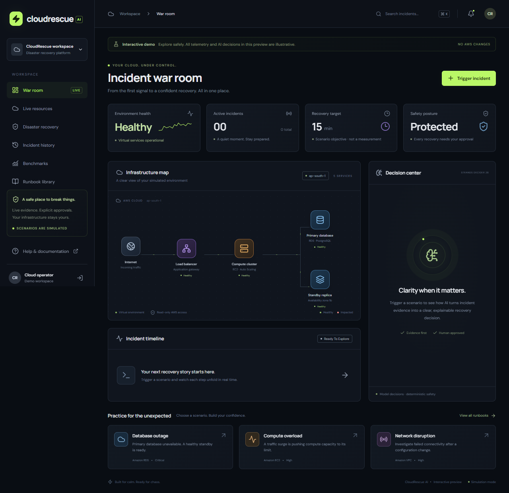

# CloudRescue AI

An AWS incident investigation dashboard with real resource discovery, timestamped CloudWatch measurements, Strands Decider recommendations and Amazon Bedrock explanations.



*Application preview with illustrative demo data. No live AWS account information is shown.*

**Safety boundary:** synthetic recovery scenarios are separate from live investigations. Live AI investigation is read-only. The real EC2/RDS restoration adapter is disabled by default and is not a production-ready regional failover solution.

## Features

- Animated, responsive React/TypeScript interface with reduced-motion support.
- Cognito authorization-code sign-in with PKCE and a JWT-protected FastAPI HTTP API.
- EC2, RDS, Lambda and S3 inventory, current CloudWatch measurements and metric alarm states.
- Explicit provenance for synthetic fixtures, live measurements, model results and missing/stale data.
- Real Decider inference through an isolated, on-demand ECS Fargate worker; optional Lambda image runtime.
- Amazon Bedrock explanations with no model-controlled AWS mutation tools.
- Thirty predefined synthetic incident cases and a reproducible classification/latency evaluation runner.
- Separately configured AWS Backup restore planning for EC2/RDS, with independent approval, expiring digests, transactional target locks, stable idempotency tokens and asynchronous job tracking.
- TypeScript AWS CDK infrastructure with private storage, encryption, retention, scoped worker roles, project tags and monitoring.

## Source layout

| Directory | Purpose |
| --- | --- |
| `frontend/src/` | Dashboard, API transport, OAuth and clearly labeled local demo |
| `backend/api/` | Authenticated API routes and operator boundaries |
| `backend/live/` | Read-only AWS discovery and CloudWatch snapshots |
| `backend/agent/` | Typed Decider selection and Bedrock narrative |
| `backend/recovery/` | Real restore plans, independent approval and AWS Backup adapter |
| `backend/simulation/` | Approved virtual recovery; no AWS remediation |
| `backend/common/` | Evidence fixtures, validation and persistence |
| `backend/decider/` | CPU inference container and model worker |
| `infrastructure/` | CDK data, application and model-build stacks |
| `evaluations/` | Synthetic labeled dataset and evaluation runner |
| `tests/` | Backend, safety, infrastructure and browser tests |
| `scripts/` | Packaging, authentication-safe checks and publication audit |

## Local preview

Requires Node.js 22.12+ and Python 3.12. PowerShell:

```powershell
npm ci
python -m venv .venv
.\.venv\Scripts\python.exe -m pip install -r backend\requirements-dev.txt
npm run dev
```

Open `http://127.0.0.1:5173`. Local preview needs no AWS credentials. Its decisions and telemetry are illustrative fixtures, not actual inference or account data. The live-resource and real-restore views do not substitute illustrative inventory.

## Configure your own AWS deployment

No deployment account, endpoint, real resource IDs, credentials, customer inventory or operator identities are included in this repository.

```powershell
Copy-Item infrastructure\cdk.context.example.json infrastructure\cdk.context.json
Copy-Item infrastructure\recovery-targets.example.json infrastructure\recovery-targets.json
```

Edit those **ignored local files** before deployment:

1. Set a compliant ownership tag and cost center in `cdk.context.json`.
2. Replace the fictitious example account in `recovery-targets.json` with your authorized account and review the primary/DR regions, scope and recovery objectives.
3. Keep `enabled: false` and `targets: []` until real recovery foundations and independently reviewed targets exist.
4. Authenticate with an authorized AWS CLI profile. Do not put access keys, passwords or tokens into source, environment files or frontend configuration.
5. Verify any chosen Bedrock model/profile and its supported destination regions. The public CDK settings are an example, not a guarantee of model access or regional capacity.

Build and review before deployment:

```powershell
npm run build
& .\scripts\package-backend.ps1
Set-Location infrastructure
npx cdk synth --strict
npx cdk bootstrap aws://YOUR_ACCOUNT/YOUR_REGION --termination-protection
npx cdk diff
npx cdk deploy --all --outputs-file outputs.json
```

Use an approved bootstrap execution policy/permissions boundary for your organization. Review the diff and expected charges. These commands create AWS resources; they do not enroll existing workloads or perform a restore. `outputs.json` and synthesized templates are local-only.

### Inference

Inference is off in the public example configuration. Build and verify the Decider container with the model-build stack, then set a private ECR image URI pinned to an immutable `sha256` digest in ignored local CDK context. Set `enableDecider: true` only after validating account memory, CPU, concurrency and networking requirements.

The Fargate adapter uses 4 vCPUs and 12 GiB RAM. Its public-subnet network has no inbound rules and outbound HTTPS access; production network design must be reviewed. No continuously running inference service is required. Inference failures escalate without fabricating a model recommendation.

### Live investigation and recovery

Discovery runs in the deployed primary region every five minutes, bounded to 100 resources per supported service. Resource state is not application health; absent measurements are not zero. S3 storage metrics are daily, and the size metric covers StandardStorage.

Live AI investigation cannot authorize a real restore. Real restoration requires configured destination recovery points, private network mappings, a restricted AWS Backup service role and a separate operator in `RecoveryApprovers`. The creator cannot approve their own plan. No operator is automatically enrolled in that group.

A completed restore job is recorded as **infrastructure restored pending validation**. The application does not automatically shut down source resources, cut over DNS, validate customer transactions, fail back or delete restored resources. An uncertain job can remain active and billable; target locks require deliberate administrative reconciliation.

Lambda standby deployment, other database/compute adapters, an outage-independent management plane, workload replication, application/data validation and traffic orchestration remain production work. Configured RTO/RPO values are objectives, not measured guarantees. Review `SECURITY.md` before any deployment.

## Validation

```powershell
npm run typecheck
npm run lint
npm run format:check
npm run test:infra
.\.venv\Scripts\python.exe -m pytest -q
.\.venv\Scripts\python.exe -m ruff check backend tests scripts evaluations
npx playwright test
```

Browser tests use installed Microsoft Edge; adjust `playwright.config.ts` for your environment.

With your own authorized deployed configuration, the synthetic model evaluation can be run using:

```powershell
.\.venv\Scripts\python.exe -m evaluations.run_benchmark --publish
```

This makes real AWS/model calls and may incur charges. Expected labels are not sent to the model. Results, actual account/runtime metadata and all screenshots stay local and are excluded from Git. Synthetic classification results do not establish production accuracy or achieved DR RTO/RPO.

## Reusable Decider decision pattern

[Recovery playbook policy classification](patterns/recovery-playbook-selection/README.md) includes the typed question, five response categories, agent integration, both inference adapters and reuse instructions. Decider classifies incident evidence before deterministic safety checks and Bedrock explanation; it does not autonomously execute production recovery.

Submission pattern tags: `#strands-decider-2b` and `#policy`.

## License

Application source and the reusable pattern are available under the [MIT license](LICENSE). Third-party dependencies, model weights and AWS services retain their respective licenses and terms.

## Publication boundary

This public repository contains source, tests and synthetic examples only. Detailed application/deployment documentation, account-specific configuration, operational records, measured reports and runtime data remain local and are ignored.

Before pushing, review the Git index and run:

```powershell
.\.venv\Scripts\python.exe scripts\check_publication.py
```

Also run an independent secrets scanner with redacted output. Never force-add ignored configuration, documentation, artifacts or credentials. No scanner can guarantee that every possible sensitive value is detected.
